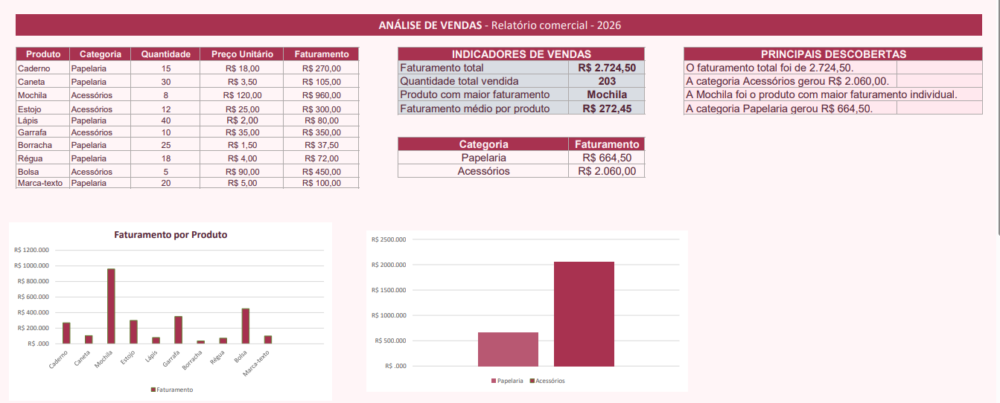

# Análise de Vendas — Excel
Sobre o projeto
Este projeto apresenta uma análise de vendas desenvolvida no Excel, com o objetivo de transformar dados comerciais em informações úteis para a tomada de decisões.

Objetivos:

-Organizar dados de produtos e vendas.
-Calcular o faturamento de cada produto.
-Identificar os produtos com maior faturamento.
-Comparar o desempenho das categorias.
-Apresentar os resultados por meio de indicadores e gráficos.

Ferramentas utilizadas:

-Microsoft Excel Online
-Fórmulas e funções do Excel
-Tabelas e gráficos
-Visualização de dados

Principais resultados:

-Faturamento total: R$ 2.724,50
-Quantidade total vendida: 203 unidades
-Produto com maior faturamento: Mochila
-Faturamento médio por produto: R$ 272,45
-Categoria com maior faturamento: Acessórios — R$ 2.060,00
-Faturamento de Papelaria: R$ 664,50

Aprendizados:

Com este projeto, pratiquei a organização de dados, o uso de fórmulas para calcular indicadores, a comparação de categorias e a criação de visualizações para comunicar resultados.

Observação:

Os dados utilizados são fictícios e foram criados para fins de aprendizado e prática.

Projeto desenvolvido como parte dos meus estudos em análise e ciência de dados.
